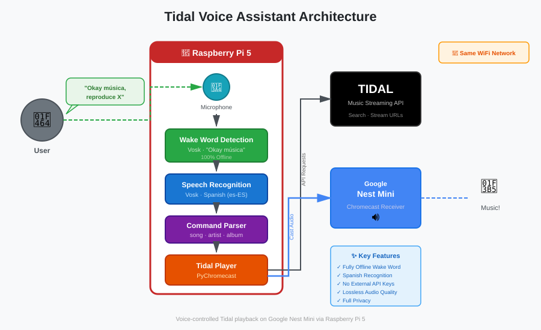

# Claude Code Context

## Project Overview

This is a **Tidal Voice Assistant** for Raspberry Pi 5 that enables voice-controlled music playback from Tidal on a Google Nest Mini (2nd generation). The project was created because Google Nest Mini doesn't support Tidal integration reliably.

## Project Conventions

### Response Style
- Be concise, minimize explanatory text. I am reaching easily Claude's rate-limits per sessions.
- Show code changes, not lengthy explanations
- Skip "here's what I did" preambles

## Problem Statement

Jorge has a Google Nest Mini (2nd gen) that he uses for:
- Weather queries
- Timers
- Music playback

**Issue**: Cannot link Tidal account to Nest Mini for voice-controlled music playback.

**Solution**: Use Raspberry Pi 5 as an intermediary that:
1. Listens for music-specific voice commands (in Spanish)
2. Searches and fetches music from Tidal
3. Casts audio to Nest Mini via Chromecast protocol
4. Keeps native "Ok Google" functionality for non-music tasks

## Technical Requirements

### Hardware
- Raspberry Pi 5 (already owned by user)
- Google Nest Mini 2nd generation
- USB microphone or microphone HAT

### Software Stack
- **Python 3.9+**
- **Vosk**: Offline wake word detection and local transcript (small Spanish model, 16 kHz)
- **Google Gemini** (`google-genai`): Command parsing from the command audio
- **tidalapi**: Tidal API integration
- **pychromecast**: Google Cast protocol for streaming to Nest Mini
- **arecord** (alsa-utils): Audio capture from ALSA `plughw:0,0` at 16 kHz mono S16_LE
- **pylast** (optional): Last.fm scrobbling
- **systemd** on the Pi, deployed with `deploy.sh` (rsync over SSH)

### Language Requirements
- All speech recognition must use **Spanish from Spain** (es-ES)
- Wake phrases: "Okey música", "Okay música" or "Ok música" (fully offline detection)
- Command parsing must understand Spanish music commands
- Voice feedback in Spanish when commands are understood

## Architecture



For a detailed visual representation of the system architecture, see [architecture.svg](architecture.svg).

**Hybrid Speech Recognition Architecture:**
- **Wake Word Detection**: Vosk in grammar mode (local, offline, about 0.5 s, ~3% CPU)
- **End of command**: an energy-based speech detector (RMS over a noise floor tracked while idle), because the small Vosk model is deaf to quiet or distant speech that Gemini hears fine
- **Local transcript**: a second Vosk recognizer with free vocabulary on the same audio stream; only a hint and the fallback input
- **Command Parsing**: Google Gemini (cloud) receives the command audio as WAV and returns `{action, query, artist, artist_alternatives, transcript}` as JSON

**Component Flow:**
- User → Microphone → `arecord` (ALSA `plughw:0,0`, 16 kHz) → AudioProcessor
- AudioProcessor (Vosk grammar recognizer) detects the wake word locally and keeps a 20 s ring buffer
- After wake word: the energy detector ends the utterance → `on_command` with audio (from 1.5 s before the wake word), local transcript, sample rate and a `reprompted` flag
- `llm_parser.py` (Gemini) parses the audio; fallback only when Gemini is unavailable: regex `command_parser.py` on the local transcript → `tidal_player.smart_search_and_play(query, search_type, artist=..., artist_alternatives=...)`
- Tidal Player ↔ Tidal API (search, stream URLs)
- Tidal Player → Pychromecast → Google Nest Mini (audio playback, with `MusicTrack` metadata)
- Chromecast media status → `ScrobbleListener` → Last.fm (optional)

## Key Components

### 1. Audio Processor (`audio_processor.py`)
- **Capture**: `arecord -D plughw:0,0 -f S16_LE -r 16000 -c 1 -t raw` as a subprocess, read in 100 ms chunks (config `AUDIO_DEVICE`, `SAMPLE_RATE`). The C-Media USB mic only captures at 44.1/48 kHz, so ALSA's `plughw` resamples to the 16 kHz the Vosk model expects. The old pipeline fed 44.1 kHz audio to the 16 kHz model, which was the main reason recognition was terrible.
- **Wake recognizer**: Vosk grammar mode with `WAKE_WORDS` (`okey música`, `okay música`, `ok música`) plus `[unk]`. Detection takes about 0.5 s and ~3% CPU.
- **Full recognizer**: a second Vosk recognizer with free vocabulary runs in parallel on the same chunks; the text after the wake phrase is the local transcript, used only as a hint (control words after an `unknown` from Gemini) and as the regex fallback input.
- **End of speech by energy**: the small model is deaf to quiet or distant speech, so the end of the command is decided by RMS over a noise floor tracked while idle (`SPEECH_RMS_MIN` 350, `SPEECH_RMS_RATIO` 2.5, `END_SILENCE_SECONDS` 0.9). Energy in the first `WAKE_TAIL_SECONDS` (0.6 s) is the tail of "música" and ignored. `SPEECH_TIMEOUT` (8 s) is the hard cap.
- **Ring buffer**: 20 s of audio; the command audio sent on is the ring from `AUDIO_PRE_WAKE_SECONDS` (1.5 s) before the wake detection to the end of speech.
- **One breath or two**: the user can say wake word and command together. If nothing is heard `EARLY_PROMPT_SECONDS` (1.2 s) after the wake word, `on_prompt` plays a short cue on the Nest Mini and listening continues for `COMMAND_NO_SPEECH_TIMEOUT` (4 s). The transcript is blanked for 1.3 s after the cue so the cue leaking into the mic does not pollute it. A short Vosk residue right after the wake word is kept as "leftover" and sent as the command after `LEFTOVER_WAIT_SECONDS` (2.5 s) if nothing else follows.
- **Re-prompt**: when `on_command` returns `"reprompt"` (Gemini heard only the wake phrase or a lone verb), the processor cues again and listens once more without dropping the audio queued meanwhile; the second attempt carries `reprompted=True` and is final.
- **Debug WAVs**: failed listening windows are saved as `/tmp/tidal-commands/timeout-HHMMSS.wav` (with 2 s before the wake); `llm_parser.py` keeps the last 10 command WAVs in the same directory. `/tmp` on the Pi is a 512 MB tmpfs.
- **Callbacks**: `on_wake_word()`, `on_prompt()`, `on_command({'audio', 'transcript', 'sample_rate', 'reprompted'})`, `on_timeout()`.
- **Backlog drain**: after each handled command, the audio queued in the `arecord` pipe meanwhile (TTS, cues) is dropped, so the speaker cannot trigger the wake word

- **False-trigger defences** (added 2026-10-30 evening after the assistant fired on ordinary conversation): the grammar hypothesis must hold for `WAKE_STABLE_CHUNKS` (300 ms), and then the last `WAKE_CONFIRM_SECONDS` (2.5 s) are re-decoded with a fresh grammar recognizer which must also find the phrase in a final result, partial hypotheses do not count (on 2026-10-31 all 8 real wakes had the phrase in the final and all 5 false triggers were partial-only hits). Every streaming trigger saves `wake-HHMMSS.wav` for offline tuning. Gemini requests are capped by `GEMINI_MAX_PER_HOUR` and `GEMINI_MAX_PER_DAY` so a runaway cannot drain the prepaid balance, and `SPEAK_NOT_UNDERSTOOD` keeps a false trigger silent.

### 1.1 LLM Parser (`llm_parser.py`)
- Sends only the command audio (WAV) to Google Gemini (`GEMINI_MODEL` `gemini-3.5-flash-lite`, `GEMINI_USE_AUDIO` True, thinking level minimal, JSON response). The local Vosk transcript is deliberately not sent in audio mode: it biased the model towards its own mistakes (for example "strauss" for The Strokes). With `GEMINI_USE_AUDIO = False` only the transcript is sent.
- The prompt tells Gemini to keep titles and names in the language heard (Catalan, English, Portuguese), never to translate, never to add an artist it did not hear, and to answer `play_artist` for a bare artist name. `KNOWN_ARTISTS` (config) plus the library's artists are sent only as a spelling aid. The household library (`library.py`: favourites, own playlists, Last.fm top of the month) is sent as a closed set of labels, about 1,500 tokens; the model may copy one back as `library_match` and `Library.lookup` refuses anything not literally in the set, so the hint cannot become an invented artist.
- Returns `{action, query, artist, artist_alternatives, transcript, library_match}`; the artist is kept separate from the query, `artist_alternatives` holds up to 2 guesses when the name was unclear
- The last 10 command WAVs are kept in `/tmp/tidal-commands/` for debugging
- Measured latency 1.4 to 2 s on the Pi
- Needs `GEMINI_API_KEY` in `.env` (Gemini API billing is prepaid; HTTP 402 when the credit is depleted). Without it the parser is disabled.
- In `main.py`, when Gemini answers `unknown`: if Vosk's transcript parses to a control command (para, siguiente, pausa, sigue) it is executed; if Gemini's transcript starts with a control word right after the wake phrase ("okey música para, ... zapatos"), that control overrides a search; if Gemini heard only the wake phrase or a single word, `on_command` returns `"reprompt"` and the processor cues once more; otherwise "No te he entendido" is spoken and the music resumes if it was playing. The regex `command_parser.py` on the local transcript (and the no-verb fallback: two or more words searched as a song) is used only when Gemini is unavailable

### 2. Phonetic Matcher (`phonetic_matcher.py`)
- Uses g2p-en for grapheme-to-phoneme conversion
- Fuzzy matching with fuzzywuzzy for Tidal search results
- Only used by the old `phonetic_search_and_play` path, which `main.py` no longer calls; the active path is `smart_search_and_play` (see 4)

### 3. Command Parser (`command_parser.py`)
- Parses Spanish music commands:
  - "reproduce [canción]" → play song
  - "pon música de [artista]" → play artist
  - "reproduce el álbum [nombre]" → play album
- Playback control commands:
  - "para" / "stop" → stop playback
  - "pausa" → pause playback
  - "continúa" / "sigue" → resume playback
  - "siguiente" / "salta" → skip track
- Playlist commands:
  - "reproduce la playlist [nombre]" → play playlist
- Uses regex patterns adapted for Spanish
- Used as fallback on the local Vosk transcript only when Gemini is unavailable (`COMMAND_PARSER = 'regex'` makes it the only parser)

### 4. Tidal Integration (`tidal_player.py`)
- OAuth device flow authentication
- Search API integration with caching
- **`smart_search_and_play(query, search_type, artist=None, artist_alternatives=None, library_match=None)`**: first `_play_from_library` (the label Gemini copied back, or a fuzzy hit at `LIBRARY_MATCH_SCORE` 80 or above against the household library, including a bare artist name at 90+) plays the exact favourite without searching; otherwise it picks the best Tidal candidate by fuzzy matching on accent-stripped text (fuzzywuzzy `token_set_ratio`), weighting the artist name 40% when known (`MATCH_GOOD_SCORE` 75 stops trying alternatives, below `MATCH_MIN_SCORE` 55 it says "No he encontrado..."). Tries the artist heard, then its alternatives, then the title alone. Playlists are looked up first in the user's own and favourited playlists (`session.user.playlists()` and `favorites.playlists()`), then in the public catalogue. A song query without artist that matches an artist name at 90+ plays the artist instead ("reproduce Pearl Jam").
- **`pause()`** stores the extrapolated position (`status.adjusted_current_time`) so `play()` resumes where the track was, not from the start; **`stop()`** logs nothing alarming when nothing was playing
- **`play_media` metadata**: every track is cast with `MusicTrack` metadata (artist, album) via `_music_metadata`, so the speaker reports what it plays (used by the scrobbler, survives restarts)
- No spoken announcement before the music (`TTS_ANNOUNCE_PLAYBACK = False`); `speak()` is used for "No te he entendido", "No he encontrado..." and the token expiry warning
- Stream URL fetching
- Session management with token refresh (auto-saves refreshed tokens)
- **Autoplay/Continuous playback**: Automatically queues similar tracks using Tidal's track radio feature
- **Internal queue tracking**: Maintains track queue that survives TTS interruption
- **Shuffle support**: Artists, playlists, and radio tracks are shuffled for variety
- **Token expiry notification**: When refresh token expires (~30 days), announces on Nest Mini in Spanish that manual re-auth is needed

### 5. Chromecast Handler (`tidal_player.py`)
- Device discovery on local network
- Media casting via pychromecast
- Handles stream URLs from Tidal
- Pre-connects at startup for faster response

### 6. Last.fm Scrobbler (`lastfm_scrobbler.py`, optional)
- `LastFmScrobbler` sends "now playing" when a track starts and scrobbles it once it played half its length or 4 minutes (tracks over 30 s only) via `pylast`, with a guard against double scrobbles on resume; `ScrobbleListener` is registered as a pychromecast media status listener in `find_chromecast`, so autoplay, skips, pauses and resumes are tracked from what the speaker reports. The Chromecast only reports status on changes, so the position reached is extrapolated from the previous status and the wall clock (a track that plays through reports 0 until it ends). `_track_info_for` resolves the title against the internal queue; a track not in the queue (queued before a restart) is trusted from the Chromecast's own metadata. TTS and cues carry no artist and are ignored.
- Needs `LASTFM_API_KEY` and `LASTFM_API_SECRET` in `.env` and `lastfm_session.json` (gitignored) from a one-time `python lastfm_auth.py` (desktop auth flow, polls until approved). `LASTFM_SCROBBLE` in `config.py` turns it off. Tidal itself exposes no listening history.

### 6.1 Household library (`library.py`)
- `Library(session, lastfm_network)` collects the Tidal favourite tracks, albums, artists and playlists (paginated, up to 500 per kind), the user's own playlists, and the Last.fm top 50 tracks and top 30 artists of the last month (`LASTFM_TOP_TRACKS`, `LASTFM_TOP_ARTISTS`). Cached in `LIBRARY_FILE` (`library.json`, gitignored, excluded from deploy) and refreshed every `LIBRARY_REFRESH_HOURS` (24) in a daemon thread; the first run without a cache refreshes synchronously (about 7 s).
- Entries are `{kind, name, artist, id, source, plays}`; the label shown to Gemini is `Name (Artist)` for tracks and albums, the bare name otherwise. `match` uses the same normalisation and `token_set_ratio` scoring as the catalogue matcher; `hint_text` lists playlists, then tracks, albums and artists, most played first, capped by `LIBRARY_HINT_*`.
- Measured on 2026-10-31: 48 favourite tracks, 31 albums, 22 artists, 36 playlists plus 18 extra tracks and 15 artists from Last.fm; hint about 4,500 characters.

### 7. Versioning, deployment and logging
- `VERSION` (semantic versioning, 2.0.0) is read by `config.py` as `VERSION`, logged at startup ("Tidal Voice Assistant v2.0.0 starting") and printed by `python main.py --version`. Bump it and tag the release (`git tag v2.0.0`).
- `./deploy.sh` rsyncs the project to the Pi (`PI_HOST`, default `cockemc@192.168.1.54`, path `/home/cockemc/tidal-voice-assistant`; excludes venv, model, `.env`, session files, logs), installs `requirements.txt` in the Pi venv, restarts `tidal-assistant` and shows status and the last log lines. `./deploy.sh --install` also copies and enables the unit.
- `tidal-assistant.service` runs as user `cockemc`, `Restart=always`, logs to the journal (`journalctl -u tidal-assistant -f`) and, via `Environment=LOG_FILE=logs/assistant.log`, to a rotating file (`RotatingFileHandler`, 5 x 5 MB) at `~/tidal-voice-assistant/logs/assistant.log`. `logs/` is gitignored. `LOG_LEVEL` comes from `.env`.

## Spanish Command Patterns

```python
# Examples of Spanish commands to support:
commands = {
    'play_song': [
        "reproduce bohemian rhapsody",
        "pon la canción de heroes del silencio",
        "reproduce todo de ti de rauw alejandro"
    ],
    'play_artist': [
        "pon música de queen",
        "reproduce canciones de metallica",
        "pon algo de rosalía"
    ],
    'play_album': [
        "reproduce el álbum a night at the opera",
        "pon el disco el madrileño",
        "reproduce el álbum de bad bunny"
    ],
    'playback_controls': [
        "para",           # stop
        "stop",           # stop
        "pausa",          # pause
        "continúa",       # resume
        "sigue",          # resume
        "siguiente",      # skip
        "salta"           # skip
    ],
    'play_playlist': [
        "reproduce la playlist rock clásico",
        "pon la lista mis favoritos"
    ]
}
```

## Configuration

### Environment Variables (`.env`)
```bash
LOG_LEVEL=INFO  # Optional: DEBUG, INFO, WARNING, ERROR, CRITICAL
GEMINI_API_KEY=  # Required for COMMAND_PARSER = 'gemini'
LASTFM_API_KEY=  # Optional, Last.fm scrobbling (plus `python lastfm_auth.py` once)
LASTFM_API_SECRET=
# LOG_FILE is set by the systemd unit (logs/assistant.log), not in .env
```

**Note**: Tidal authentication uses OAuth device flow, no credentials needed in `.env`

### Config File (`config.py`)
```python
TIDAL_CONFIG = {
    'quality': 'HIGH',  # LOSSLESS, HIGH, LOW (account tier currently returns AAC HIGH)
    'session_file': 'tidal_session.json'
}

# Autoplay Configuration
AUTOPLAY_ENABLED = True   # Enable continuous playback after a song ends
AUTOPLAY_TRACK_COUNT = 10 # Number of similar tracks to queue for autoplay

CHROMECAST_NAME = "Altavoz Google"  # User's Nest Mini name

# Wake Word and Speech Recognition
WAKE_WORDS = ['okey música', 'okay música', 'ok música']  # Vosk grammar mode
VOSK_MODEL_PATH = "vosk-model-small-es-0.42"
SPEECH_TIMEOUT = 8               # Max seconds of command audio after the wake word
COMMAND_NO_SPEECH_TIMEOUT = 4.0  # After the prompt cue, give up if nothing is said this long
AUDIO_PRE_WAKE_SECONDS = 1.5     # Audio kept before the wake detection for the LLM

# Audio Configuration
AUDIO_DEVICE = "plughw:0,0"   # ALSA device; plughw resamples the USB mic's 44.1/48 kHz to 16 kHz
SAMPLE_RATE = 16000

# Command Parsing
COMMAND_PARSER = 'gemini'     # 'gemini' or 'regex'
GEMINI_MODEL = 'gemini-3.5-flash-lite'
GEMINI_USE_AUDIO = True       # Send the command audio; False sends only the Vosk transcript
KNOWN_ARTISTS = [...]         # Spelling aid for Gemini, merged with the library's artists
LIBRARY_REFRESH_HOURS = 24    # Household library (favourites, playlists, Last.fm top) refresh; LIBRARY_MATCH_SCORE 80, LIBRARY_HINT_* caps

# TTS and cues
TTS_ENGINE = 'google'         # 'google' (recommended) or 'local' (pyttsx3)
TTS_ANNOUNCE_PLAYBACK = False # No "Reproduciendo X de Y": the music is the feedback (saves ~7 s)
TTS_SHORT_ANNOUNCEMENTS = False  # Only relevant when TTS_ANNOUNCE_PLAYBACK is True
PLAYBACK_CUES = False         # Timeout/error cues on the speaker; the wake cue after a pause always plays

# Last.fm
LASTFM_SCROBBLE = True
LASTFM_SESSION_FILE = 'lastfm_session.json'
```

The speech detector constants (`SPEECH_RMS_MIN`, `SPEECH_RMS_RATIO`, `END_SILENCE_SECONDS`, `WAKE_TAIL_SECONDS`, `EARLY_PROMPT_SECONDS`, `LEFTOVER_WAIT_SECONDS`, `PROMPT_BLANK_SECONDS`) live at the top of `audio_processor.py`; the match thresholds (`MATCH_GOOD_SCORE`, `MATCH_MIN_SCORE`) in `tidal_player.py`.

## Usage Flow

### Music Playback Flow
1. **User says**: "Okey música, reproduce Bohemian Rhapsody"
2. **Wake word detected**: Vosk detects "okey música" locally (offline, about 0.5 s); music is paused if playing (no cue)
3. **Utterance captured**: the energy detector ends the utterance 0.9 s after the voice stops; ring buffer audio (from 1.5 s before the wake phrase) and the local transcript are collected
4. **Cloud parsing**: Gemini receives the command audio (1.5 to 2 s)
5. **Parsed**: Gemini returns `play_song` with query "Bohemian Rhapsody" and artist "Queen"
6. **Searched**: `smart_search_and_play` searches Tidal (about 1 s) and picks the best candidate by fuzzy match, weighting the artist
7. **Streamed**: Pychromecast sends the stream URL with artist and album metadata to the Nest Mini (2 to 3 s to load); nothing is announced
8. **Playback**: Music plays on the Nest Mini about 5 s after the end of the command; Last.fm gets "now playing"
9. **Autoplay**: Similar tracks are automatically queued for continuous playback

**Autoplay Behavior:**
- **Single song**: Plays the requested track, then queues 10 similar tracks from Tidal's track radio (shuffled)
- **Artist**: Queues up to 20 top tracks from the artist (shuffled)
- **Album**: Queues all tracks from the album in order (not shuffled, preserves album order)
- **Playlist**: Queues all tracks from the playlist (shuffled)

Autoplay can be disabled by setting `AUTOPLAY_ENABLED = False` in `config.py`.

### Playback Control Flow (Context-Aware)
When music is playing, the system is context-aware:

1. **User says**: "Okey música"
2. **Wake word detected**: Vosk detects trigger phrase locally
3. **Music paused**: `on_wake_word` pauses playback (remembering `was_playing` and the extrapolated position) so the mic doesn't pick up music
4. **Short cue**: if nothing is heard 1.2 s after the wake word, `on_prompt` plays a short beep on the Nest Mini and listening continues for 4 s
5. **Command captured**: Audio recorded without music interference (transcript blanked for 1.3 s after the cue)
6. **Cloud parsing**: Gemini parses the audio
7. **Parsed**: action identified (stop/skip/pause/resume/new search). If Gemini says `unknown` but Vosk caught "para", "siguiente", "pausa" or "sigue", that control command runs; if Gemini heard only the wake phrase or one word, the cue plays again and the assistant listens once more
8. **Executed**: Action performed (stop is silent, resume continues from the stored position)
9. **Smart resume**: If the command is not understood ("No te he entendido") or nothing is said, music resumes only if it was playing before; the timeout cue plays only with `PLAYBACK_CUES = True`
10. **Backlog drop**: audio captured while the command was handled is discarded so the speaker cannot retrigger the wake word

For non-music commands, user continues using:
- "Ok Google, ¿qué tiempo hace?"
- "Ok Google, pon un temporizador"

## Development Priorities

### Phase 1: Core Functionality (Completed)
- [x] Wake word detection (Vosk-based, fully offline)
- [x] Vosk grammar mode for improved wake word accuracy
- [x] Spanish speech recognition (hybrid: Vosk + Gemini)
- [x] Basic command parsing
- [x] Tidal authentication (OAuth device flow)
- [x] Chromecast streaming
- [x] Testing utilities
- [x] Comprehensive wake word testing and troubleshooting
- [x] Logging system with configurable levels
- [x] Retry mechanisms with exponential backoff
- [x] Basic playback control (stop, pause, resume)
- [x] **Autoplay/Continuous playback** (queues similar tracks automatically)
- [x] **Full album and artist playback** (queues all tracks with shuffle)

### Phase 2: Enhanced Features (Completed)
- [x] 16 kHz ALSA capture via `arecord`/`plughw` (2026-10-30 rewrite)
- [x] Gemini command parsing from audio (2026-10-30 rewrite)
- [x] Search result caching
- [x] Internal queue tracking (survives TTS interruption)
- [x] **Skip track functionality** ("siguiente", "salta", "pasa la canción")
- [x] **Playlist support** ("reproduce la playlist X")
- [x] Energy-based end of speech, early cue, re-prompt and debug WAVs (2026-10-30)
- [x] Last.fm scrobbling (2026-10-30)
- [x] Versioning (`VERSION`), `deploy.sh`, rotating log file (2026-10-30)
- [x] Household library matched before the catalogue and sent to Gemini as a closed set (2026-10-31)
- [ ] Volume control via voice

### Phase 3: Advanced Features
- [ ] Multi-room audio
- [ ] Web interface
- [ ] Home Assistant integration
- [ ] Catalan language support (relevant for Menorca)

## Testing Strategy

### Unit Tests
- Command parser with Spanish variations
- Tidal API integration
- Chromecast discovery and connection

### Integration Tests
- End-to-end voice command flow
- Network connectivity
- Audio streaming quality

### Manual Tests
- Microphone audio quality
- Wake word sensitivity
- Speech recognition accuracy
- Latency measurements

## Known Issues & Limitations

1. **CPU Usage**: ~3% for the wake recognizer (grammar mode) plus roughly 12% of one core for the free-vocabulary recognizer
2. **Latency**: wake word about 0.5 s, then about 5 s from the end of the command to music (Gemini 1.5 to 2 s, Tidal search about 1 s, Chromecast load 2 to 3 s)
3. **Microphone**: the C-Media USB mic is the weak point (noisy, 48 kHz only, misses quiet or distant speech); a far-field USB speakerphone or mic array is the recommended upgrade. The large Vosk model (`vosk-model-es-0.42`) was tested and rejected: no grammar mode, 4.3 GB RAM, near real-time CPU, no accuracy gain. Mic gain 16/16 with AGC off is persisted via `alsactl store`; the Pi fan thresholds were raised in `/boot/firmware/config.txt` (outside the repo) to cut noise
4. **Network Dependency**: Requires stable WiFi for command parsing (Gemini API, prepaid billing, 402 when depleted) and Chromecast
5. **Wake Word Offline**: Wake word detection and the local transcript work without internet; only command parsing needs network (regex fallback otherwise)
6. **Tidal API**: Rate limits may apply for heavy usage
7. **Language**: Currently only Spanish from Spain (could add Catalan)
8. **Chromecast Queue**: TTS and cues interrupt the Chromecast queue (mitigated with internal queue tracking)
9. **Tests**: `tests/test_command_parser.py::test_pon_song` fails (pre-existing, regex fallback only)

## Security Considerations

- OAuth tokens stored in `tidal_session.json` (gitignored)
- No passwords stored: OAuth device flow only
- Wake word processing is local and offline (no cloud)
- `GEMINI_API_KEY` and the Last.fm keys live in `.env` (gitignored); `lastfm_session.json` is gitignored too
- Command audio (from 1.5 s before the wake phrase to the end of speech) is sent to Gemini only after wake word detected; copies are kept in `/tmp/tidal-commands` (tmpfs) for debugging
- No encryption on local audio capture (acceptable for home use)

## Performance Considerations

Measured on a Raspberry Pi 5:
- **Wake word detection**: about 0.5 s, ~3% CPU (Vosk grammar mode)
- **End of speech**: 0.9 s of silence after the voice stops (energy detector)
- **Command parsing**: 1.5 to 2 s (Gemini, audio only)
- **Tidal search**: about 1 s (cached for repeated queries)
- **Chromecast load**: 2 to 3 s (pre-connected at startup)
- **Total response time**: about 5 s from the end of the command to music playback (no spoken announcement)

## Dependencies

### System Packages
```bash
alsa-utils          # arecord (audio capture), amixer, alsactl
python3-venv python3-pip git
ffmpeg              # Optional, only for the test scripts
```

No system Python audio packages are needed. The venv on the Pi is created with `python3 -m venv --system-site-packages venv`.

### Python Packages
```
vosk                # Wake word detection and local transcript (offline)
google-genai        # Gemini command parsing
tidalapi            # Tidal API
pychromecast        # Chromecast protocol
python-dotenv       # Environment variables
requests            # HTTP utilities
g2p-en, fuzzywuzzy, nltk, python-Levenshtein  # Fuzzy and phonetic matching
gtts, pyttsx3       # Text-to-speech (Google / local)
pylast              # Last.fm scrobbling (optional)
pytest              # Tests: python -m pytest tests -q
```

## File Structure

```
tidal-voice-assistant/
├── main.py                      # Entry point (--version)
├── config.py                    # Configuration, logging (rotating file), VERSION
├── VERSION                      # Semantic version (2.0.0)
├── audio_processor.py          # ALSA capture (arecord), Vosk wake word, energy-based end of speech
├── llm_parser.py               # Gemini command parser (command audio)
├── command_parser.py           # Regex parser for Spanish commands (fallback)
├── phonetic_matcher.py         # Phonetic matching for fuzzy search
├── tidal_player.py             # Tidal + Chromecast
├── tidal_auth.py               # Tidal authentication
├── lastfm_scrobbler.py         # Last.fm scrobbling (optional, from Chromecast media status)
├── library.py                  # Household library: favourites, playlists, Last.fm top (matched first, closed set for Gemini)
├── lastfm_auth.py              # One-time Last.fm authorisation
├── tts_engine.py               # TTS engine (Google or local pyttsx3)
├── utils.py                    # Utility functions and decorators
├── test_chromecast.py          # Chromecast testing
├── test_tidal.py               # Tidal testing
├── tests/                      # Unit tests (command parser, phonetic matcher, Last.fm scrobbler, library)
├── requirements.txt            # Python deps
├── .env.example                # Environment template
├── setup.sh                    # Setup script for the Pi
├── deploy.sh                   # rsync to the Pi, pip install, service restart (--install)
├── tidal-assistant.service     # Systemd service (user cockemc, journal + logs/assistant.log)
├── improvements.md             # Future improvement ideas
├── logs/                       # Rotating log file on the Pi (gitignored)
└── vosk-model-small-es-0.42/   # Spanish Vosk model (~58 MB on disk, downloaded)
```

## User Experience Goals

1. **Seamless Integration**: Voice commands feel natural
2. **Low Latency**: 3-5 seconds from command to playback
3. **High Accuracy**: Spanish recognition >90% accurate
4. **Reliable**: Handles network issues gracefully
5. **Transparent**: User knows when using Pi vs Nest Mini

## Future Evolution Ideas

### Multi-Language Support
- Add Catalan (co-official language in Menorca)
- Language detection or explicit switching

### Home Automation Integration
- Integrate with Home Assistant
- Room-aware audio (multiple Nest Minis)
- Automation triggers (play music when arriving home)

### Advanced Music Features
- Create/manage playlists via voice
- ~~Radio mode (continuous playback)~~ ✅ Implemented via autoplay
- Music recommendations
- Lyrics display (if screen available)

### Technical Improvements
- Use better Spanish models (larger Vosk models)
- GPU acceleration for speech recognition
- Custom wake word training
- Web dashboard for configuration

## Resources & References

- **Vosk Models**: https://alphacephei.com/vosk/models
  - Using: `vosk-model-small-es-0.42` (~58 MB on disk, low memory usage)
  - Used for wake word detection (grammar mode) and the local transcript

- **Google Gemini API** (`google-genai`): https://ai.google.dev/gemini-api/docs
  - Parses the command from the audio alone
  - Needs `GEMINI_API_KEY`; billing is prepaid

- **Pychromecast**: https://github.com/home-assistant-libs/pychromecast
  - Google Cast protocol implementation
  - Device discovery and media control

- **Tidal API**: https://github.com/tamland/python-tidal
  - Unofficial Python client
  - OAuth device flow authentication
  - Search and streaming

## Contact & Context

- **User**: Jorge (Cloud Security Engineer)
- **Location**: Menorca, Balearic Islands, Spain
- **Context**: Personal home automation project
- **Goal**: Enable Tidal on Nest Mini via Raspberry Pi bridge

## Notes for Claude Code

When working on this project:

1. **Language**: All voice commands are in Spanish (Spain variant)
2. **Hardware**: Raspberry Pi 5 is available, microphone needed
3. **Testing**: User wants to test Chromecast casting first
4. **User Expertise**: Jorge is highly technical, comfortable with CLI and code
5. **Priorities**: Functionality over polish in first iteration
6. **Future**: Open to enhancements and additional features

## Quick Start Commands for Development

```bash
# Setup
sudo apt install -y alsa-utils python3-venv python3-pip git
python3 -m venv --system-site-packages venv
source venv/bin/activate
pip install -r requirements.txt
cp .env.example .env   # set GEMINI_API_KEY

# Download Spanish model (~58 MB on disk)
wget https://alphacephei.com/vosk/models/vosk-model-small-es-0.42.zip
unzip vosk-model-small-es-0.42.zip

# Microphone: raise gain, disable AGC, persist, and test a 16 kHz recording
amixer -c 0 cset numid=3 16
amixer -c 0 cset numid=4 off
sudo alsactl store
arecord -D plughw:0,0 -f S16_LE -r 16000 -c 1 -d 5 test.wav && aplay test.wav

# Test Chromecast
python test_chromecast.py --discover
python test_chromecast.py --test

# Authenticate Tidal (OAuth device flow, follow URL in output)
python tidal_auth.py

# Optional: Last.fm scrobbling (keys in .env first)
python lastfm_auth.py

# Run application
python main.py
python main.py --version

# Unit tests
python -m pytest tests -q

# Deploy to the Pi from the workstation and watch the log
./deploy.sh              # ./deploy.sh --install the first time
ssh cockemc@192.168.1.54 tail -f tidal-voice-assistant/logs/assistant.log
```

This context should help you understand the project's goals, architecture, and technical requirements for future development sessions.
