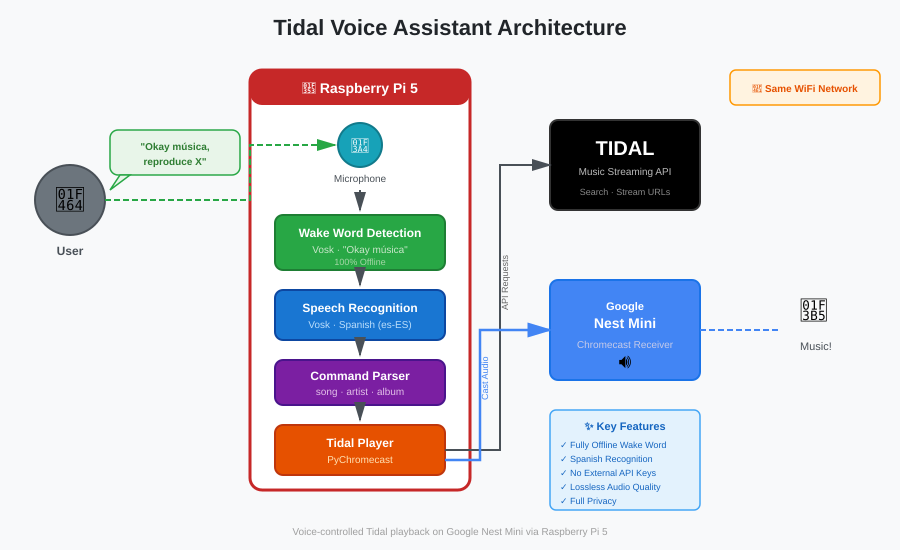

# Tidal Voice Assistant for Raspberry Pi

## 🎯 Project Goal

This project creates a voice-controlled Tidal music player using a Raspberry Pi 5 that casts music to a Google Nest Mini. It allows you to use voice commands in Spanish to play music from Tidal, while keeping the Nest Mini's native "Ok Google" functionality for other tasks like weather, timers, and general queries.

**Why this exists**: Google Nest Mini doesn't support Tidal integration reliably, so this solution uses a Raspberry Pi as a bridge to enable voice-controlled Tidal playback.

## 🏗️ Architecture



**Flow**:
1. Say wake phrase: "Okey música" (also "Okay música" or "Ok música")
2. Speak music command in Spanish: "Reproduce Rosalía" (in the same breath, or after the cue if you pause)
3. Vosk detects the wake phrase offline; an energy-based speech detector decides when the command ends, and Vosk's local transcript is only a hint
4. The command audio goes to Google Gemini, which returns a structured intent (action, query, artist, alternative artists)
5. Searches Tidal API (fuzzy matching picks the best candidate, weighting the artist when known; playlists are looked up first in your own library)
6. Streams audio to Nest Mini via Chromecast, about 5 s after the end of the command; the music itself is the feedback, nothing is announced
7. For non-music commands, continue using "Ok Google" directly on Nest Mini

**Note**: Audio is captured with `arecord` at 16 kHz from ALSA (`plughw:0,0`). Wake word detection uses Vosk in grammar mode (wake phrases plus `[unk]`, about 0.5 s and ~3% CPU). A second Vosk recognizer with free vocabulary runs in parallel to produce a local transcript, but the small model is deaf to quiet or distant speech that Gemini hears fine, so the end of the command is decided by speech energy (RMS over a noise floor tracked while idle). Gemini receives only the command audio (the local transcript biased it towards its own mistakes with foreign names) and is told to keep titles in the language heard and never to add an artist it did not hear. Only if Gemini is unavailable does the regex parser in `command_parser.py` work on the local transcript. After each command the audio backlog from the pipe is dropped, so sounds from the Nest Mini cannot trigger the wake word.

**Why the rewrite (2026-10-30)**: the previous version fed 44.1 kHz microphone audio to a 16 kHz Vosk model (the main reason recognition was so poor) and relied on the unofficial free Google Speech endpoint for command transcription. Both were replaced: ALSA `plughw` now resamples to 16 kHz for Vosk, and Gemini parses the command from the audio itself.

## 📋 Hardware Requirements

- **Raspberry Pi 5** (4GB+ recommended)
- **MicroSD Card** (32GB+, Class 10)
- **Microphone**: a cheap C-Media USB mic works (ALSA resamples its 44.1/48 kHz capture to 16 kHz) but it is the weak point of the setup; a far-field USB speakerphone or a mic array is the recommended upgrade
- **Google Nest Mini** (2nd generation or later)
- Both devices on the same WiFi network

## 🔧 Software Requirements

- Raspberry Pi OS (64-bit recommended)
- Python 3.9+
- Active Tidal subscription
- Google Gemini API key (prepaid billing, a few euros last months)

## 📦 Installation

### Step 1: System Setup

```bash
# Update system
sudo apt update && sudo apt upgrade -y

# Install system dependencies
sudo apt install -y python3-pip python3-venv alsa-utils git

# Optional: ffmpeg, only needed by the test scripts
# sudo apt install -y ffmpeg

# Optional: Install espeak for local TTS (uses Google TTS by default)
# Note: Requires symlink: sudo ln -sf /usr/lib/*/libespeak-ng.so.1 /usr/lib/libespeak.so.1
# sudo apt install -y espeak-ng libespeak-ng1

# Clone this repository
git clone <your-repo-url>
cd tidal-voice-assistant

# Create virtual environment
python3 -m venv --system-site-packages venv
source venv/bin/activate

# Install Python packages
pip install -r requirements.txt
```

### Step 2: Download Spanish Speech Recognition Model

```bash
# Download Vosk Spanish model (~58 MB on disk)
wget https://alphacephei.com/vosk/models/vosk-model-small-es-0.42.zip
unzip vosk-model-small-es-0.42.zip
rm vosk-model-small-es-0.42.zip
```

The small model is used both for wake word detection (grammar mode) and for the local transcript.

### Step 3: Configure Environment Variables

```bash
# Copy example environment file
cp .env.example .env

# Set the Gemini API key and, optionally, the log level and the Last.fm keys
nano .env
```

```bash
GEMINI_API_KEY=your-key   # Required for the Gemini command parser (create at https://aistudio.google.com/apikey)
LOG_LEVEL=INFO            # Default: INFO, DEBUG, WARNING, ERROR, CRITICAL
LASTFM_API_KEY=           # Optional, see Last.fm Scrobbling below
LASTFM_API_SECRET=
```

**Note**: Tidal credentials are not needed in `.env`, authentication uses OAuth. Without `GEMINI_API_KEY` the assistant falls back to the regex parser on the local Vosk transcript, which is much less accurate with artist and song names.

### Step 4: Authenticate with Tidal

```bash
python tidal_auth.py
```

This will:
1. Display a URL to visit in your browser
2. Ask you to authorize the application
3. Save the session for future use

Follow the link, log in to Tidal, and authorize the app.

### Step 5: Set Up the Microphone

```bash
# Find the USB mic (card number, usually 0)
arecord -l

# Raise the mic gain and disable Auto Gain Control (C-Media USB mic, card 0)
amixer -c 0 cset numid=3 16
amixer -c 0 cset numid=4 off
sudo alsactl store   # Persist across reboots

# Record 5 seconds at the rate the assistant uses and play it back
arecord -D plughw:0,0 -f S16_LE -r 16000 -c 1 -d 5 test.wav
aplay test.wav
```

If the card number is not 0, update `AUDIO_DEVICE` in `config.py` (`plughw:<card>,0`). Then run `python main.py` with `LOG_LEVEL=DEBUG` and say "Okey música" to test detection.

### Step 6: Find Your Nest Mini Name

```bash
python test_chromecast.py --discover
```

This will list all Chromecast devices on your network. Note the exact name of your Nest Mini.

### Step 7: Verify Configuration

Check that `config.py` has your correct Nest Mini name:

```python
CHROMECAST_NAME = "Altavoz Google"  # Should match name from discovery
```

## 🧪 Testing Chromecast Connection

Before running the full voice assistant, test that your Pi can cast to the Nest Mini:

### Quick Pychromecast Test

```bash
# Activate virtual environment
source venv/bin/activate

# Run the test script
python test_chromecast.py --test
```

This will:
1. Discover your Nest Mini
2. Generate a test MP3 file with Spanish text-to-speech
3. Cast it to your Nest Mini

### Manual Testing with Custom MP3

If you have your own MP3 file:

```bash
# Place your MP3 in the project directory
cp /path/to/your/music.mp3 ./test_audio.mp3

# Cast it to Nest Mini
python test_chromecast.py --file test_audio.mp3
```

### Testing with Tidal Stream

Test a Tidal track directly:

```bash
python test_tidal.py "Bohemian Rhapsody Queen"
```

### Expected Output

```
Discovering Chromecasts...
Found: Living Room speaker (192.168.1.100)
Found: Bedroom display (192.168.1.101)

Connecting to 'Living Room speaker'...
Connected successfully!

Playing test audio...
Audio should now be playing on your Nest Mini
```

**Troubleshooting**:
- If no devices found: Check both devices are on same WiFi network
- If connection fails: Restart your Nest Mini
- If audio doesn't play: Check Nest Mini volume isn't muted

## 🎤 Microphone Setup

### Test Your Microphone

```bash
# List audio devices
arecord -l

# Show the mixer controls of the mic (gain, AGC)
amixer -c 0 contents

# Record a 5-second test at 16 kHz mono through plughw (ALSA resamples from the mic's native 44.1/48 kHz)
arecord -D plughw:0,0 -f S16_LE -r 16000 -c 1 -d 5 test.wav

# Play it back
aplay test.wav
```

### If the recording is too quiet

```bash
# Mic gain to maximum (numid from `amixer -c 0 contents`, 3 on the C-Media mic)
amixer -c 0 cset numid=3 16

# Disable Auto Gain Control
amixer -c 0 cset numid=4 off

# Persist the mixer state
sudo alsactl store
```

The assistant opens the device set in `AUDIO_DEVICE` (`plughw:0,0` by default) directly, so no `~/.asoundrc` is needed.

## 🎧 Last.fm Scrobbling (optional)

Tidal does not expose any listening history, and it never learns what the Pi plays (the assistant only fetches stream URLs). The assistant can scrobble what the speaker plays to Last.fm instead, following the Last.fm rules: "now playing" when a track starts, and a scrobble once it has played half its length or four minutes. Tracks shorter than 30 seconds, TTS messages and cues are ignored. Track changes, autoplay, skips and pauses are read from the Chromecast's own media status, so nothing is counted that did not actually play.

1. Create an API account at https://www.last.fm/api/account/create (callback URL and homepage can stay empty) and put the key and shared secret in `.env` as `LASTFM_API_KEY` and `LASTFM_API_SECRET`.
2. Authorise your Last.fm user once: `python lastfm_auth.py` prints a URL; open it, approve, and the script polls until Last.fm hands back the session key, saved to `lastfm_session.json` (gitignored, does not expire).
3. Restart the assistant. The log shows `Last.fm scrobbling ready`; without keys or session it just logs that scrobbling is off.

The Chromecast receives the artist and album as track metadata, so a track queued before a restart of the assistant is still scrobbled correctly, and a resume after a pause does not scrobble the same play twice. `LASTFM_SCROBBLE = False` in `config.py` disables it. For what you play in the Tidal app itself, use a scrobbler on the device (for example Pano Scrobbler on Android, or the Web Scrobbler browser extension for Tidal web).

## 🚀 Running the Application

### Interactive Mode (Recommended for testing)

```bash
source venv/bin/activate
python main.py
```

`python main.py --version` prints the version from the `VERSION` file. You should see:
```
Tidal Voice Assistant v2.0.0 starting
Pre-connecting to Chromecast...
Chromecast ready: Altavoz Google
Loading Vosk model from vosk-model-small-es-0.42
LLM parser ready (gemini-3.5-flash-lite, audio=True)
Starting capture: arecord -q -D plughw:0,0 -f S16_LE -r 16000 -c 1 -t raw
Listening for wake words ['okey música', 'okay música', 'ok música'] on plughw:0,0 @ 16000 Hz
```

### Example Commands (in Spanish):

**Music playback:**
- **"Okay música, reproduce Rosalía"** → Play song
- **"Okay música, pon música de Bad Bunny"** → Play artist's top tracks
- **"Okay música, reproduce el álbum El Madrileño"** → Play album
- **"Okay música, pon canciones de Metallica"** → Play artist
- **"Okay música, reproduce la playlist rock clásico"** → Play playlist

**Playback controls:**
- **"Okay música, para"** or **"stop"** → Stop playback
- **"Okay música, pausa"** → Pause playback
- **"Okay música, continúa"** or **"sigue"** → Resume playback
- **"Okay música, siguiente"** or **"salta"** → Skip to next track

**Tip**: say the command in the same breath as the wake phrase. If nothing is heard 1.2 s after "Okey música", the Nest Mini plays a short cue and keeps listening for 4 seconds. If Gemini hears only the wake phrase or a lone verb ("reproduce..."), the cue plays once more and the assistant listens again. When the command is not understood it says "No te he entendido" and resumes the music if it was playing. A bare name ("reproduce Pearl Jam") plays the artist. Gemini handles international artist and song names well; the regex fallback on the local transcript does not.

### Non-Music Commands (use Nest Mini directly):

- **"Ok Google, ¿qué tiempo hace?"** → Handled by Nest Mini
- **"Ok Google, pon un temporizador de 5 minutos"** → Handled by Nest Mini
- **"Ok Google, cuéntame un chiste"** → Handled by Nest Mini

## 🔄 Running as a Service (Auto-start on Boot)

The unit `tidal-assistant.service` runs `main.py` from the venv as user `cockemc` in `/home/cockemc/tidal-voice-assistant`, loads `.env` as `EnvironmentFile`, restarts always (10 s delay) and logs to the journal and, through `Environment=LOG_FILE=logs/assistant.log`, to a rotating file. Adjust `User`, `Group`, `WorkingDirectory`, `EnvironmentFile` and `ExecStart` if your user or path differ.

```bash
# On the Pi: install, enable and start
sudo cp tidal-assistant.service /etc/systemd/system/
sudo systemctl daemon-reload
sudo systemctl enable --now tidal-assistant

# Check status and logs
systemctl status tidal-assistant
journalctl -u tidal-assistant -f
tail -f ~/tidal-voice-assistant/logs/assistant.log
```

### Deploying from a workstation

`deploy.sh` rsyncs the project to the Pi (excluding `venv`, the Vosk model, `.env`, session files and `logs`), installs `requirements.txt` in the Pi venv, restarts the service and prints its status and the last log lines. `PI_HOST` overrides the target (default `cockemc@192.168.1.54`).

```bash
./deploy.sh              # rsync, pip install, restart, status
./deploy.sh --install    # also installs and enables the systemd unit
PI_HOST=pi@raspberrypi.local ./deploy.sh
```

### Versioning

The version lives in the `VERSION` file (semantic versioning, currently 2.0.0). `config.py` reads it, it is logged at startup and `python main.py --version` prints it. Bump `VERSION` and tag the release (`git tag v2.0.0`) when publishing.

### Token Renewal

Tidal tokens auto-refresh, but the refresh token expires (~30 days). When this happens:

1. **Voice notification**: The Nest Mini will announce in Spanish: *"Atención. La sesión de Tidal ha caducado. Por favor, ejecuta la autenticación manualmente."*
2. **Manual re-auth required**:
   ```bash
   cd ~/tidal-voice-assistant
   source venv/bin/activate
   python tidal_auth.py
   sudo systemctl restart tidal-assistant
   ```

## 📝 Project Structure

```
tidal-voice-assistant/
├── README.md                    # This file
├── CLAUDE.md                    # Project context for coding assistants
├── PROJECT_STRUCTURE.md         # Detailed file descriptions
├── improvements.md              # Future improvement ideas
├── architecture.svg             # Architecture diagram
├── VERSION                      # Semantic version, read by config.py
├── requirements.txt             # Python dependencies
├── .env.example                 # Environment variables template
├── setup.sh                     # Setup script for the Pi
├── deploy.sh                    # rsync to the Pi, pip install, restart the service
├── config.py                    # Application configuration (logging, version, tuning)
├── main.py                      # Main application entry point
├── audio_processor.py          # ALSA capture (arecord), Vosk wake word, energy-based end of speech
├── llm_parser.py               # Gemini command parser (command audio)
├── command_parser.py           # Regex parser for Spanish music commands (fallback)
├── phonetic_matcher.py         # Phonetic matching for fuzzy search
├── tidal_player.py             # Tidal API and Chromecast integration
├── tidal_auth.py               # Tidal authentication
├── lastfm_scrobbler.py         # Last.fm scrobbling from the Chromecast media status (optional)
├── lastfm_auth.py              # One-time Last.fm authorisation
├── tts_engine.py               # TTS engine (local pyttsx3 or Google)
├── utils.py                    # Utility functions and decorators
├── test_chromecast.py          # Chromecast testing utilities
├── test_tidal.py               # Tidal integration testing
├── tests/                       # Unit tests (python -m pytest tests -q)
│   ├── test_command_parser.py
│   ├── test_lastfm_scrobbler.py
│   └── test_phonetic_matcher.py
├── tidal-assistant.service     # Systemd service file
├── logs/                        # Rotating log file when LOG_FILE is set (gitignored)
└── vosk-model-small-es-0.42/   # Spanish speech recognition model (downloaded)
```

## 🐛 Troubleshooting

### Wake Word Not Detected
- Verify the mic is visible and on card 0: `arecord -l` (otherwise update `AUDIO_DEVICE` in `config.py`)
- Record and listen to a 16 kHz test: `arecord -D plughw:0,0 -f S16_LE -r 16000 -c 1 -d 5 test.wav && aplay test.wav`
- Check the mixer: `amixer -c 0 contents`, then raise the gain (`amixer -c 0 cset numid=3 16`) and disable AGC (`amixer -c 0 cset numid=4 off`)
- Run `python main.py` with `LOG_LEVEL=DEBUG` and watch the log
- Speak clearly: "Okey música" (Vosk grammar mode only accepts the phrases in `WAKE_WORDS`)

### Assistant triggers during normal conversation
Vosk in grammar mode sometimes guesses the wake phrase for the first syllables of a sentence. Two defences are on by default: the hypothesis must hold for 300 ms, and the last 2.5 s are re-decoded with a fresh recognizer that must find the phrase again. Every trigger saves `wake-HHMMSS.wav` under `/tmp/tidal-commands`, so false triggers can be replayed offline. Gemini requests are capped (`GEMINI_MAX_PER_HOUR`, `GEMINI_MAX_PER_DAY` in `config.py`), and a false trigger stays silent unless `SPEAK_NOT_UNDERSTOOD` is enabled.

### Command Not Understood
- Verify the Spanish model is downloaded to `vosk-model-small-es-0.42/`
- Check that `GEMINI_API_KEY` is set in `.env`: the log shows `LLM parser ready` at startup, or `GEMINI_API_KEY not set, LLM parser disabled`
- If Gemini fails (`Gemini parse failed` in the log) check network and API billing; the regex fallback on the local transcript is used meanwhile
- If Gemini answers `unknown` the assistant says "No te he entendido" (unless Vosk caught a control word such as "para" or "siguiente", which is then executed); listen to what Gemini heard with `aplay /tmp/tidal-commands/<timestamp>.wav` (the last 10 command WAVs are kept there, failed listening windows as `timeout-HHMMSS.wav` with 2 s before the wake phrase). `/tmp` on the Pi is a 512 MB tmpfs, so the files vanish on reboot
- Wrong song picked: run with `LOG_LEVEL=DEBUG` to see the candidates and their fuzzy scores; say the artist too ("reproduce X de Y") since the artist name weighs 40% of the score
- Say the command right after the wake phrase; if you pause, wait for the cue and then speak
- Quiet or distant speech: the end of the command is detected by energy over the noise floor (`SPEECH_RMS_MIN`, `SPEECH_RMS_RATIO`, `END_SILENCE_SECONDS` in `audio_processor.py`); the DEBUG log prints the floor and the RMS when speech starts
- The large Vosk model (`vosk-model-es-0.42`) was tested and rejected: no grammar mode, 4.3 GB of RAM, near real-time CPU and no accuracy gain. A better microphone helps far more than a bigger model

### Chromecast Not Found
- Ensure Pi and Nest Mini on same WiFi network
- Check firewall: `sudo ufw status`
- Restart Nest Mini
- Run discovery: `python test_chromecast.py --discover`

### Tidal Authentication Fails
- Delete `tidal_session.json` and re-run: `python tidal_auth.py`
- Make sure to follow the OAuth URL in your browser
- Verify Tidal subscription is active
- Check internet connection

### Audio Quality Issues
- Tidal quality is set to `'HIGH'` in `config.py` (the account tier currently returns AAC HIGH); `'LOSSLESS'` only works on a HiFi tier
- Check network bandwidth
- Reduce WiFi interference

### Microphone Sensitivity Issues
If the wake word detection is unreliable:

1. **Check microphone levels:**
   ```bash
   # List mic controls with their numids
   amixer -c 0 contents

   # Set mic gain to maximum (numid=3 on the C-Media USB mic)
   amixer -c 0 cset numid=3 16

   # Disable Auto Gain Control (it pumps the level and hurts recognition)
   amixer -c 0 cset numid=4 off

   # Persist across reboots
   sudo alsactl store
   ```

2. **Verify the correct card** is used: `arecord -l`, then set `AUDIO_DEVICE = "plughw:<card>,0"` in `config.py`. Keep `plughw` (not `hw`) so ALSA resamples to 16 kHz for Vosk.

3. **Reduce the Pi's own noise** (optional): the fan sits next to the mic. Raising the fan temperature thresholds in `/boot/firmware/config.txt` (`dtparam=fan_temp0=...`) keeps it quiet at idle; this is outside the repo.

### Python Dependencies Issues
```bash
# Reinstall in clean environment
rm -rf venv
python3 -m venv --system-site-packages venv
source venv/bin/activate
pip install --upgrade pip
pip install -r requirements.txt
```

## 📊 Logging

Set the log level in your `.env` file:

```bash
LOG_LEVEL=INFO      # Default, normal operation
LOG_LEVEL=DEBUG     # Verbose output for troubleshooting
LOG_LEVEL=WARNING   # Only warnings and errors
```

**Where to see logs:**
- **Manual run**: Logs appear in the terminal
- **As a service**: `journalctl -u tidal-assistant -f`, and the rotating file `~/tidal-voice-assistant/logs/assistant.log` (5 files of 5 MB, enabled by `LOG_FILE=logs/assistant.log` in the unit; set `LOG_FILE` yourself for a manual run)

## 🔐 Security Notes

- Never commit `.env` file to version control
- Keep `tidal_session.json` and `lastfm_session.json` private
- Keep `GEMINI_API_KEY` and the Last.fm keys in `.env` only, never in code or commits
- Wake word detection is fully offline; only the command audio (about 1.5 s before the wake phrase to the end of speech) is sent to Gemini after the wake word
- Command WAVs kept in `/tmp/tidal-commands` for debugging live on a tmpfs and disappear on reboot

## 🚧 Known Limitations

- Wake word detection takes about 0.5 s and ~3% CPU (Vosk grammar mode); the parallel free-vocabulary recognizer adds roughly 12% of one core
- End to end on a Raspberry Pi 5: music starts about 5 s after the end of the command (Gemini 1.5 to 2 s, Tidal search about 1 s, Chromecast load 2 to 3 s)
- The C-Media USB mic is the weak point: quiet or distant speech is often missed by Vosk (Gemini copes better); a far-field mic is the recommended upgrade
- Command parsing needs network access to the Gemini API (prepaid billing, HTTP 402 when the credit is depleted); the regex fallback is much weaker
- The cue played after a pause leaks into the mic, so the transcript is blanked for 1.3 s after it
- Tidal API rate limits may apply for heavy usage
- Tidal refresh tokens expire (~30 days); a voice notification will alert you
- Chromecast queue is lost during TTS (mitigated with internal queue tracking)

## 🛣️ Future Enhancements

- [x] Fully offline wake word detection (no external APIs)
- [x] Vosk grammar mode for improved wake word accuracy
- [x] Hybrid speech recognition (Vosk wake word and local transcript, Gemini command parsing from audio)
- [x] Fuzzy candidate selection on accent-stripped text, with user and favourite playlists searched first
- [x] 16 kHz ALSA capture through `plughw` (fixes the sample rate mismatch of the first version)
- [x] Autoplay/continuous playback (queues similar tracks)
- [x] Full album and artist playback (queues all tracks, shuffled)
- [x] Playlist support (with shuffle)
- [x] Skip track functionality (with internal queue tracking)
- [x] Local TTS option (offline announcements)
- [x] Search result caching
- [x] Configurable wake word patterns
- [x] Distinct audio cues (wake/success/error/timeout)
- [x] Unit tests
- [x] Last.fm scrobbling from the Chromecast media status
- [x] Energy-based end of speech, re-prompt on hesitation, command WAVs kept for debugging
- [x] Versioned releases and one-command deployment (`deploy.sh`)
- [ ] Volume control via voice
- [ ] Multi-language support (Catalan, etc.)
- [ ] Web interface for configuration
- [ ] Integration with Home Assistant

## 🌐 External API Dependencies

This project contacts the following external services:

| Service | Purpose | URL(s) | Library |
|---------|---------|--------|---------|
| **Google Gemini API** | Command parsing from the command audio (after wake word) | `https://generativelanguage.googleapis.com/*` | google-genai |
| **Google Translate TTS** | Spoken messages on Nest Mini ("No te he entendido", "No he encontrado...", token expiry) | `https://translate.google.com/translate_tts` | Direct URL |
| **Last.fm API** (optional) | Now playing and scrobbles | `https://ws.audioscrobbler.com/2.0/` | pylast |
| **Google Actions Sounds** | Activation beep sound | `https://actions.google.com/sounds/v1/alarms/beep_short.ogg` | Direct URL |
| **Tidal API** | Music search, streaming URLs, track radio | `https://api.tidal.com/*` | tidalapi |
| **Tidal Auth** | OAuth authentication | `https://auth.tidal.com/*`, `https://login.tidal.com/*` | tidalapi |

**Local/Offline components:**
- **Vosk**: wake word detection and local transcript run entirely offline using the downloaded Spanish model
- **Chromecast**: communication with Nest Mini happens on the local network (mDNS discovery plus local streaming)

## 📚 Resources

- [Vosk Speech Recognition](https://alphacephei.com/vosk/)
- [Pychromecast Documentation](https://github.com/home-assistant-libs/pychromecast)
- [Tidal API (tidalapi)](https://github.com/tamland/python-tidal)

## 📄 License

MIT License: feel free to modify and distribute

## 🤝 Contributing

Contributions welcome! Please open an issue or pull request.

## ✨ Credits

Created as a solution for Tidal integration with Google Nest Mini devices.
